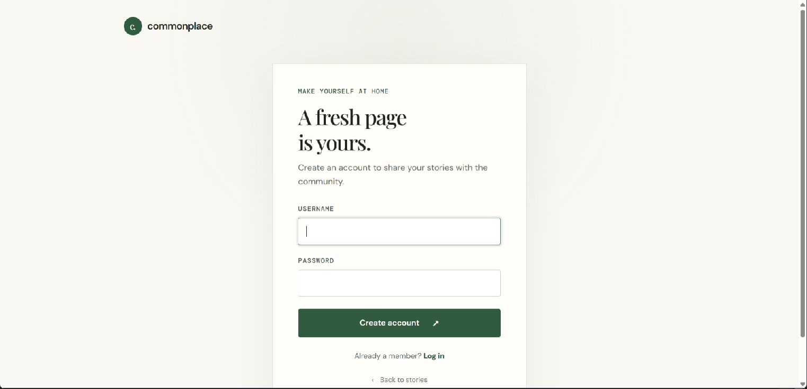
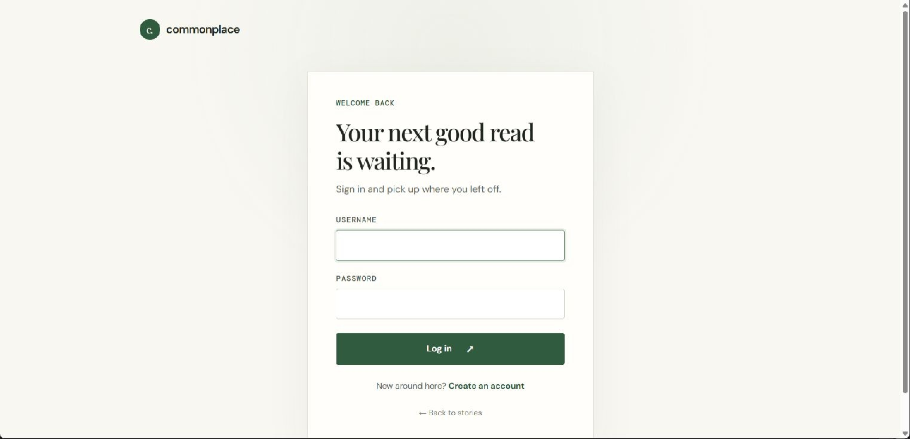

# Fullstack Blogging App

A Spring Boot blogging app with account registration and login, and pages to create and view posts. It uses Thymeleaf for the web UI, Spring Security for authentication, Spring Data JPA for persistence, and an in-memory H2 database by default.

## Screenshots

The app has a quiet public home page, simple account forms, and a focused writing screen.

### Home


### Create an account



### Log in



## Features

- Browse published stories on the home page.
- Create an account, log in, and write a story.
- Server-side authentication and validation with Spring Security.
- In-memory H2 database for a zero-setup local run.
- Responsive layout with larger, high-contrast form labels and readable body text.

## Requirements

- Java 17 or newer
- Maven 3.6 or newer

## Run locally

From the project directory, run:

```powershell
mvn spring-boot:run
```

Wait until Maven prints `Started BloggingApplication`, then open [http://localhost:8080](http://localhost:8080) in your browser. Register an account and sign in to create posts.

To stop the app, press `Ctrl+C` in the terminal where Maven is running. The default H2 database is in memory, so accounts and posts are cleared when the app stops. The H2 console is available at [http://localhost:8080/h2-console](http://localhost:8080/h2-console) while the app is running.

The `PORT` environment variable can override the default when running the app or Docker image. If startup reports that port 8080 is in use, stop the other process using that port, then start the app again.

## Build and run the JAR

```powershell
mvn package
java -jar target/blogging-app-1.0.0.jar
```

## Configuration

The default configuration is in `src/main/resources/application.properties`. It uses the embedded H2 database and listens on port `8080` (or the value of `PORT`).

## Docker

Build the JAR first, then build and run the image:

```powershell
mvn -DskipTests package
docker build -t fullstack-blogging-app .
docker run --rm -p 8080:8080 fullstack-blogging-app
```

Open [http://localhost:8080](http://localhost:8080). To use another host port, change the first port, for example `-p 8082:8080`.
